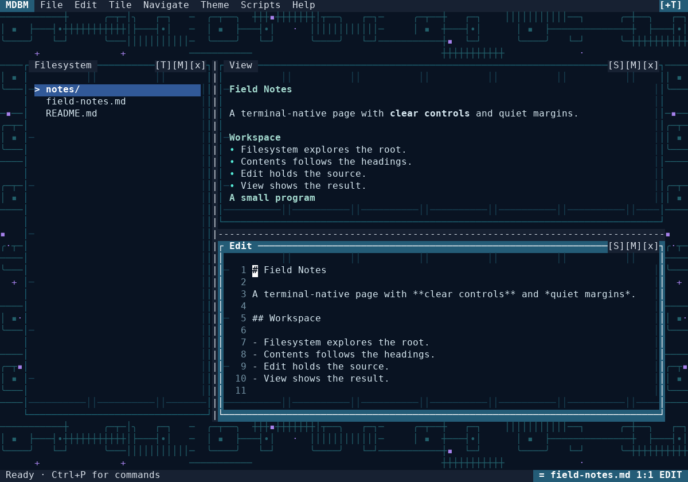
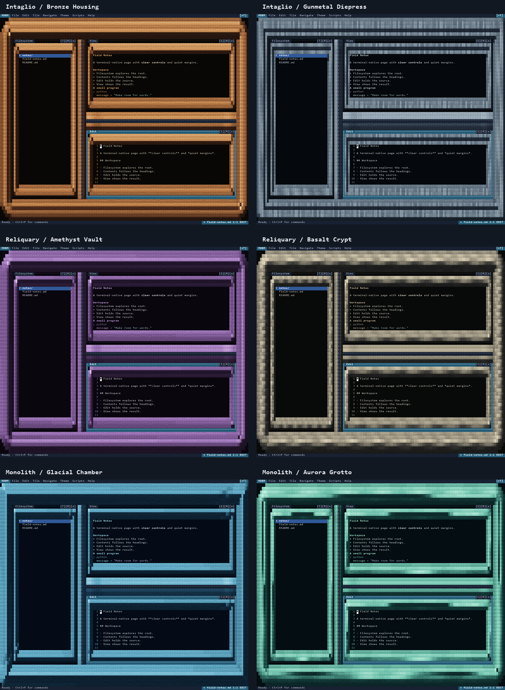

# mdbm

**A cell-native Markdown reader/editor for the terminal.**

Version **1.0.0a4** is a runnable implementation alpha, not a declaration that every acceptance gate in the supplied plan has passed. The application has one runtime Python source, `mdbm.py`. Themes are validated TOML data; they cannot execute code or operate the editor.

The [November 2026 improvement pass](docs/IMPROVEMENT_PASS_2026-11-03.md)
adds a searchable document switcher, search across open buffers, and guarded
Save All. It also repairs multi-document recovery, preview handoffs,
Windows state-lock probing, installed theme discovery, and ongoing CI.

The [continuation](docs/EXTENSION_PASS_2026-11-03.md) adds bounded per-document
recovery storage and a recovery inventory, background file/state work and
open-buffer search, cached Markdown reflow, deferred fragment navigation,
workspace presets, maximize/restore and transactional appearance controls.



## Start on Windows

Extract the complete folder to a writable location. Install Python **3.11 or newer** if it is not already available. Open **`1Setup.cmd`** once to create a local virtual environment and install the declared dependencies. Then open **`0Start.cmd`**, preferably in Windows Terminal.

These launchers do not install Python, change system settings, or bypass failed dependency installation. Setup needs package-index access. An existing environment is reused; it is not deleted.

From a terminal in the extracted folder:

```powershell
py -3 -m venv .venv
.venv\Scripts\python.exe -m pip install -r requirements.txt
.venv\Scripts\python.exe mdbm.py examples\tour.md
```

Without a path, MDBM opens its welcome document or offers the saved session. A file argument roots the workspace at that file's parent directory. A directory argument opens that directory as the workspace.

## Start on Linux or macOS

```sh
python3 -m venv .venv
.venv/bin/python -m pip install -r requirements.txt
.venv/bin/python mdbm.py examples/tour.md
```

Subsequently, `./start.sh` launches the same environment. The extracted source bundle is the recommended installation. Editable installation is also supported: `python -m pip install -e .`. A wheel includes the reference themes under `share/mdbm`; when running an installed wheel, place `mdbm.conf` in your working directory or pass `--config`. Scripts in a wheel installation still follow the explicit sibling-of-`mdbm.py` policy; the extracted bundle is more convenient for that workflow.

## Using the workspace

Filesystem occupies the left column; its **[T]** button switches to Contents without discarding tile memories. View starts above Edit. The right-hand **[S]** buttons swap their order; **[M]** opens a compact tile menu and **[x]** hides a tile. **[+T]**, the Tile menu and **Ctrl+T** restore hidden tiles. At small sizes the application shows one focused tile rather than crushing all four into unusable rectangles.

Clicking an unfocused tile focuses it and performs the clicked action. Drag in Edit to select text, double-click for a word, and triple-click for a line. Right-clicking inside a selection preserves it. Clicking ordinary preview text reveals its source block; existing editor selections are retained. Stale preview links/source maps are held until the current generation is ready.

Drag either one-cell divider with the left or right mouse button. Release commits; Escape rolls back. An outside click dismisses the top overlay without also editing the document. Theme selection is transactional: arrows preview, Enter commits, Escape restores the original. An uncommitted preview cannot leak into saved session state.

| Action | Keyboard |
| --- | --- |
| Command palette / emergency route | **Ctrl+P** |
| Restore all tiles | **Ctrl+T** |
| Open / new / save / Save As | **Ctrl+O / Ctrl+N / Ctrl+S / F4** |
| Switch document, filtering by name or path | **Ctrl+B** |
| Quit, with dirty-state guard | **Ctrl+Q** |
| Focus next / previous tile | **Tab / Shift+Tab** |
| Direct tile focus | **Alt+1 … Alt+4** |
| Switch left tile / swap right tiles | **Alt+L / Alt+W** |
| Find / next / previous / replace | **Ctrl+F / F3 / F7 / F6** |
| Go to line or `line:column` | **Ctrl+G** |
| Undo / redo; select all | **Ctrl+Z / Ctrl+Y; Ctrl+A** |
| Copy / cut / application paste | **Ctrl+C / Ctrl+X / Ctrl+V** |
| Ribbon / guide / dismiss | **F10 / F1 / Escape** |

The palette exposes commands without dedicated shortcuts, including keyboard split resizing, theme selection, Contents filtering and script cancellation. Alt-prefixed keys can also be entered as Escape then the key where the terminal supports that convention. The ribbon uses a latched fallback, not a claim of portable Alt-key-release detection. Ctrl+H is kept compatible with Backspace; it is deliberately not Replace.

The clipboard is **application-local**. Pasting from the operating system uses the terminal's own paste shortcut and bracketed-paste protocol. MDBM does not write OSC-52 clipboard escapes.

### Working across documents

Up to **32 documents** can stay open, with their own text, undo history,
selection, scroll and preview. The tab strip keeps the active document
visible; **Ctrl+B** provides a filterable list when tabs overflow. Type
parts of a filename or relative path, then press Enter or click a result.
An asterisk marks unsaved text. Escape leaves the current document alone.

**Navigate → Search open documents** searches the current in-memory text
of every open buffer, including unsaved and untitled documents. Search is
literal and case-sensitive. Results show a filename, one-based source
line and character column, and a short excerpt. Enter selects the match in
Edit. Results are capped at 200; a changed or closed document cannot reuse
an obsolete result. This command searches open buffers only; it does not
scan unopened files on disk.

Interactive searches run in a cancellable background job. Escape closes the
search without publishing a late result. Only one pending query is retained;
editing or closing a buffer still invalidates that buffer's old matches.

**File → Save all changed documents** saves dirty buffers in tab order.
Untitled buffers prompt for Save As, and changed destinations retain the
usual conflict confirmation. Cancel or an error stops the remaining saves;
earlier successful saves remain on disk. When the batch finishes, the
original document becomes active again. All these commands are also
available through **Ctrl+P**.

Interactive opens and saves run in the background. You can keep typing while
a save finishes; the submitted text is saved and any newer edits stay dirty.
A guarded close/quit or Save All continuation stops if newer unsaved edits
remain. Pending saves reserve both their source and destination until the
controller acknowledges completion.

### Drag-and-drop files in a terminal

MDBM has **no portable native OS drag/drop event**. Some terminal emulators insert
a dropped file's pathname as **bracketed paste**; other terminals deliver
different data or do not support file drops. In compatible terminals, focus
Filesystem, Contents, or View (or use Vim Normal/Visual mode in Edit), then
drop or paste a recognizable local path. MDBM opens it through the same
workspace-root and multi-document lifecycle as **Ctrl+O**.

One local path, individually single-/double-quoted paths (including spaces),
POSIX backslash-escaped spaces, Windows drive-letter paths on Windows, and
newline-separated path lists are recognized. Unquoted multi-path strings with
ambiguous spaces are **not** split. Each file must be an existing local,
UTF-8 regular file admitted by the current workspace's SafeFiles policy.
Outside-root paths, state paths, symlinks/junctions, URLs, and shell-like
syntax are refused. Valid paths in a multi-file drop remain open even when
another member is rejected. MDBM never invokes a shell or expands commands,
globs, environment variables, or tilde for terminal paste.

**Edit insertion mode and all text-entry dialogs receive pasted paths as
literal text by default.** Drops from a non-edit workspace context preserve
that tile's keyboard focus, so repeated drops consistently open documents
without redirecting the next paste into Edit. Focus **Filesystem** (Alt+1),
**Contents** (Alt+2) or **View** (Alt+4); the mouse pointer's drop location
does not reliably determine which tile receives terminal input.

To intentionally open a dropped file while **Edit** is focused, press **F9**
(or choose **File → Arm next file-path paste**) immediately beforehand.
The next bracketed-paste payload is handled as a single file-open attempt
rather than inserted into the document. An unrecognized payload changes
neither document nor files. Escape, ordinary typing or opening a dialog
cancels this one-shot override. Normal Edit paste remains unchanged after
the attempt.

Actual terminal-emulator behaviour varies; use Ctrl+O if your terminal does
not deliver dropped paths as bracketed paste. A documented Vim subset
supplies Normal/Insert/Visual modes; it is not a complete Vim emulator.
The detailed keyboard/mouse and mode contracts are in
`docs/MDBM_PRODUCT_SPEC.md` and F1.

## Reading and editing

The preview supports CommonMark, tables, task lists, strikethrough, HTTP(S) autolinks, footnotes and Pygments fenced-code styling. HTML is rendered literally, not executed. No remote images are fetched. Local links must remain in the rooted workspace; external browser links require confirmation.

Files are UTF-8. Existing BOMs and uniform newline conventions are preserved; mixed line endings are diagnosed and normalized to the dominant convention on save. Existing unsafe controls remain in the source but render as safe replacements. New pasted controls are sanitized. Combining marks and CJK widths are handled at cell boundaries; some ambiguous emoji/ZWJ sequences display as replacement cells while retaining their source.

Saves publish atomically and check disk fingerprints. Existing destinations, changed files, dirty navigation and exit all require the appropriate guard. Rename/move refuses overwriting an existing destination. Trash uses Send2Trash with **no permanent-delete fallback**. No-clobber creation requires hard-link support on the destination filesystem and fails safely when unavailable. These checks are not isolation from an adversarial process running as the same OS user.

## Appearance and configuration

**Tile → Choose workspace preset…** offers Default, Writing, Reading and Review
layouts, together with up to eight named custom layouts. Preview a layout,
then apply it or cancel; per-document cursors, selections and scroll memories
survive the change. Focused-tile maximize/restore temporarily expands the
current tile without replacing the saved split layout; **Alt+M** invokes it.

**Theme → Appearance and accessibility…** previews colour depth, ASCII rendering, high contrast,
motion and spacing in one panel. Apply commits the choices; Escape/Cancel
restores the previous settings. Only committed preferences enter session
state, and `mdbm.conf` remains untouched. The static **Quiet Study** theme
provides a restrained reading/writing option with narrow, ASCII and monochrome
fallbacks. The [tailored UI contract](docs/MDBM_TUI_UX_SPEC.md) records the
source-pinned design decisions and qualification boundaries.

The [theme catalogue](docs/THEME_CATALOG.md) lists **22 additional themes** with
launch IDs, guides and previews, alongside the six original file-based themes.

The **Solid material relief** collection develops the sculpted trio into six
filled, shaded designs: `intaglio-bronze`, `intaglio-gunmetal`,
`reliquary-amethyst`, `reliquary-basalt`, `monolith-glacial`, and
`monolith-aurora`. These are now continuous sculpted environments: **32 paired
foreground/background tones** wrap around the actual borders, corners, tile
openings and dividers under consistent upper-left lighting. Update the renderer
and themes together for geometry-fitted frames and per-cell styles. See
[the material guide](examples/solid-relief-showcase.md) and
[previews with multi-scale shading checks](docs/screenshots/solid-relief/gallery.html).



The **Sculpted ASCII relief** trio adds `iron-intaglio`, `obsidian-reliquary`,
and `glacier-monolith`: hand-drawn die plates, carved vaults and fractured ice
using printable ASCII contours and hatching. See [the guide](examples/sculpted-ascii-showcase.md),
[plain NFO artwork](examples/relief-studies.nfo), and [actual-cell previews](docs/screenshots/relief/gallery.html).
Use a 140 x 58 terminal for the full relief; all three themes are static.

For a heavier ANSI/NFO aesthetic, the **Underground NFO collection** adds
`rust-bastion`, `void-cathedral`, `acid-overdrive`, `cryo-vault`, `cinder-relic`,
and `static-revenant`: extruded block mastheads, distressed shaded borders,
raised modules and slow particles. See [the NFO showcase](examples/nfo-theme-showcase.md)
and [actual-cell previews](docs/screenshots/nfo/gallery.html). A 140 x 52 terminal
shows the full designs; smaller layouts simplify their decoration.

Six additional appearance themes are available: `botanical-ledger`,
`tidal-observatory`, `ember-foundry`, `polar-blueprint`, `velvet-nocturne`, and
`desert-cartography`. They include three light/static and three dark/animated
designs. See [the theme showcase](examples/appearance-theme-showcase.md) for
palettes and usage, and [the actual-cell comparison gallery](docs/screenshots/appearance/gallery.html)
for previews. Launch any of them with `python mdbm.py --theme <id>`.

MDBM now ships three original reference themes — `restrained-monochrome`, `neon-circuitry` and `dense-glitch-mosaic` — plus three animated examples: `maintenance-ecosystem`, `relay-moth-swarm`, and `diagnostic-aurora`. `minimal` remains embedded for recovery. The animated set is directly inspired by the motion language of `maintenance_ecosystem_v4_2`: service lamps/crawlers, relay moth formations, coolant and diagnostic aurora/arc effects, re-expressed strictly as safe theme data.

See `docs/screenshots/gallery.html` for static compositor snapshots and `docs/screenshots/animated/gallery.html` for GIF captures generated from the actual compositor. Open `examples/animated-theme-showcase.md` in MDBM for a live tour. **F8** is bound to `cue.user-1` in the sample config so Maintenance Ecosystem and Diagnostic Aurora can fire their manual arc-storm demo.

```sh
python mdbm.py --theme maintenance-ecosystem examples/animated-theme-showcase.md
python mdbm.py --theme relay-moth-swarm examples/animated-theme-showcase.md
python mdbm.py --theme diagnostic-aurora examples/animated-theme-showcase.md
python mdbm.py --theme dense-glitch-mosaic
python mdbm.py --safe-theme --no-restore
python mdbm.py --validate-theme themes/neon-circuitry.theme
python mdbm.py --config mdbm.conf --diagnostics
python mdbm.py examples/tour.md --snapshot 120x40
```

`mdbm.conf` stays manually maintained; the program never rewrites its comments. It controls layout, artspace, input, appearance, capabilities, accessibility, scripts and recovery. Configuration bindings map a key sequence to an existing command ID. Invalid values fall back individually; conflicting bindings produce diagnostics. Some advanced semantic theme surfaces from the requested plan are not implemented yet; the implementation report identifies them rather than claiming complete 1.1 conformance.

Normal content is opaque to decoration. Immersive behind-content art is opt-in; protected focus, selection, cursor, controls, menus and confirmations remain host-owned. Motion can be off, reduced, normal or high, with user accessibility settings taking precedence. Spatial/glyph tracks may run at the bounded theme cadence; whole-style, palette and visibility transitions remain capped at 2 Hz. Themes have strict size, reference, art, layer, frame and per-frame paint budgets.

## Recovery and scripts

Session and recovery data live in the configured local `.mdbm/` directory. A dirty recovery snapshot is separate from the source file: it does **not** silently save over that file. Restoring it retains the original disk fingerprint, so later external edits still trigger conflict checks. Snapshots are local plaintext, not encrypted. State-owner checks retain live or uncertain owners, and Windows probes do not send console signals. Copy the source files and recovery directory before destructive troubleshooting.

A previous session's snapshot is preserved before the new session starts
writing recovery. **Later** and `--no-restore` keep that snapshot for a
subsequent launch. Opening a specific file and restoring or discarding its
recovery preserves the other documents in the same bundle. Recovery is
validated before changing the open buffers, and differing current unsaved
text is never silently replaced. Unchanged recoverable state does not
rewrite the snapshot every interval.

New recovery bundles use small manifests and individually checked UTF-8
content blobs, with the same source-byte limit on writing and reading. Old
version 1/2 snapshots remain readable. The recovery inventory exposes deferred
snapshots in newest-first pages, including snapshots beyond the former
64-entry discovery cutoff. Restore and discard are explicit, and archived
snapshots do not expire silently. Storage-limit failures preserve the previous
valid snapshot and appear as diagnostics. A persistent OS-held guard serializes
primary-owner acquisition, including simultaneous attempts to reclaim a dead
session. See the continuation report for the storage budgets and migration
details.

Scripts are trusted programs, **not a sandbox**. Only explicitly allowlisted `.py` siblings of `mdbm.py` are shown; `mdbm.py` itself is excluded. Arguments must be a JSON array such as `["a path with spaces", "--check"]`. The host invokes the current interpreter with shell disabled and captures bounded output. Themes and documents cannot launch them. POSIX cancellation terminates the process group; Windows cancellation currently targets the launched process, not every descendant.

## Verification and release status

```sh
python -m pip install -e ".[test]"
python -m pytest -q
python tests/performance_probe.py --output docs/verification/performance.json
python tests/render_gallery.py
python tests/render_animation_gallery.py
```

The current source-bound results and remaining findings are recorded in
[the continuation report](docs/EXTENSION_PASS_2026-11-03.md). The permanent
[CI workflow](.github/workflows/tests.yml) runs the full suite on Ubuntu
with Python 3.11 and 3.13 and on Windows with Python 3.13. Every job requires
the real Markdown plugins, builds a wheel, and checks installed console
entry points plus all packaged themes in both target and prefix layouts.

The suite includes **96 deterministic golden configurations**, real POSIX
pseudo-terminal interactions, recovery/data-loss regressions, deterministic
preview interleavings, and a live-child state-lock probe on both platforms.
PTY assertions reconstruct the visible terminal screen before checking text;
raw escape sequences are retained for terminal-mode cleanup checks.
Golden baselines remain implementation regression fixtures, not an independent
visual oracle. `tests/update_goldens.py` updates them explicitly; review the
gallery rather than accepting changed hashes blindly. This pass does not
change the golden baselines.

The 513-test/bootstrap-parser measurements in the original implementation
report are retained as historical evidence. This pass installs and tests
the declared release dependencies without weakening their bounds.

Native Windows Terminal, macOS/Linux GUI-terminal acceptance, reference-machine
end-to-end latency and accessibility/flash auditing remain open. Source edits
still use a full-document Markdown parse in the background. Width/ASCII reflow
reuses valid parsed Markdown, fragment navigation waits for matching preview
work, and open-buffer search plus file/recovery publication run off the
interactive input loop. The continuation records large-document measurements,
including tail latency; compositor timing alone does not qualify physical
terminal latency. Startup restoration, filesystem enumeration and some
administrative file operations remain synchronous.

Start with copies of valuable documents while evaluating this alpha. The exact delivered scope, remaining gaps, measurements and commands are in **`docs/IMPLEMENTATION_REPORT.md`**.

## Package map

`mdbm.py` is the sole runtime Python source; `mdbm.conf` and `themes/*.theme` are data. `examples/tour.md` is an interactive exercise; `examples/animated-theme-showcase.md` is the live animated-theme tour. `tests/` contains non-runtime checks, fixtures, the benchmark and gallery tools. `docs/` contains the product and technical contracts, config/theme specifications, security model, acceptance plan, roadmap, implementation prompt, original requested plan, measured verification data and screenshots. The supplied CI definition is under `.github/workflows/`.
