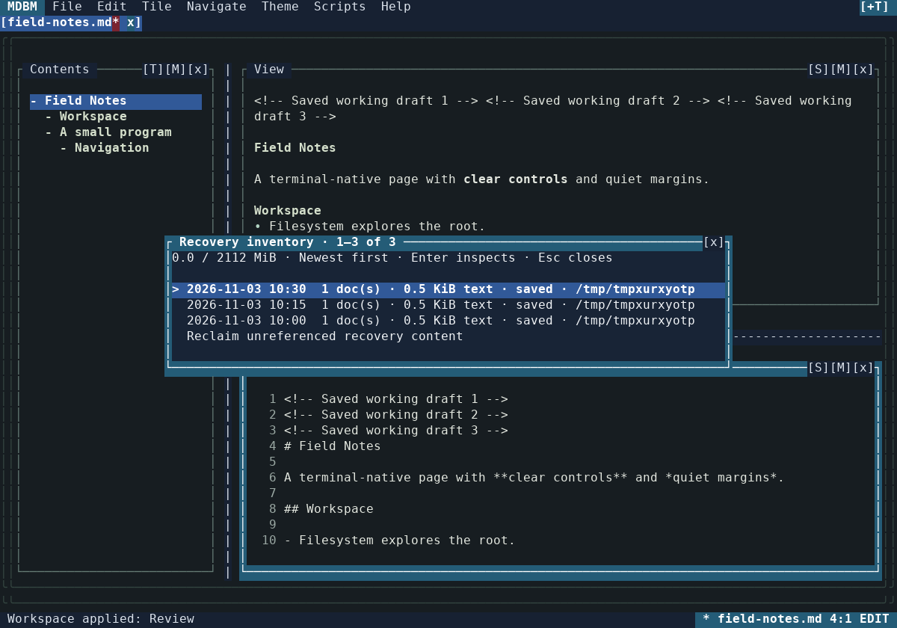

# MDBM 1.0.0a4 — recovery, responsiveness and workspace extension

This continuation implements the three follow-up areas identified in the
[first improvement pass](IMPROVEMENT_PASS_2026-11-03.md). The review base is
[`15a3e0b61bf008a6a5ea5e06abee1959ca7ae21a`](https://github.com/techrote/mdbm/commit/15a3e0b61bf008a6a5ea5e06abee1959ca7ae21a).
The application remains an implementation alpha; automated evidence and native
terminal qualification are reported separately.

## Review and implementation plan

| Review finding | Required result | Implementation decision |
| --- | --- | --- |
| A 32-document recovery bundle can exceed its own reader budget, especially with JSON escaping | Anything accepted for publication must be recoverable under the same limits | Separate UTF-8 source blobs from a bounded metadata manifest; read old snapshots through a bounded streaming envelope |
| Discovery truncates the unsorted archive list before inspecting timestamps | Every retained snapshot must be reachable | Newest-first metadata discovery and a paginated, explicit recovery inventory |
| Simultaneous stale-lock reclaimers can unlink a successor's ownership file | One live primary owner through crashes and simultaneous startup | Hold an operating-system lock on a persistent guard file; retain conservative legacy-owner checks |
| Width changes reparse unchanged Markdown | Resize should reuse the current parsed document | Separate parse and layout work and bound cached parsed documents |
| Fragment navigation and open-buffer search can block the controller | Keep input available and reject obsolete completions | Deferred navigation intents and cancellable background search with source ownership tags |
| File and recovery writes run on the input loop | Publish safely without freezing editing or losing newer text | Bounded serial disk worker, immutable save snapshots, coalesced autosnapshots and ordered shutdown |
| Presentation choices lack a unified workspace workflow | Make advanced layout and appearance choices reversible and discoverable | Transactional workspace/appearance choosers, named presets and focused-tile maximize/restore |

The implementation sequence is recovery/storage first, then background work,
then workspace and appearance controls. Independently owned changes are
integrated and cross-reviewed before the full regression, package and native
CI gates. Existing source-conflict, rooted-path, pointer-parity and protected
compositor invariants remain acceptance requirements for every extension.

## Design basis

The UI work uses the standalone tile-native UI/UX specification at
[`specdocz` revision `04568d38e832ed60dfcba8e8e991dc25d62cc8cb`](https://github.com/techrote/specdocz/tree/04568d38e832ed60dfcba8e8e991dc25d62cc8cb/uiuxs/tuiuiux).
The direct implementation specification is an implementation pattern guide;
the MDBM-derived documents provide examples. The project's security and file
integrity contracts take precedence. The tailored UI specification records
the concrete adopted, adapted and extended behavior.

The central choices are persistent tile identity, one semantic command
registry for keyboard and pointer routes, geometry-derived hit regions,
preview/commit/cancel transactions, protected host controls, and decoration
that yields to readable content in small terminals.

## Background file and state work

Interactive open constructs the document and source-line index on the disk
worker. Results are published only if their workspace still exists. Saves
capture immutable text, newline/BOM policy, destination and expected disk
fingerprint. The worker uses the existing same-directory atomic publication
and conflict checks. Only the controller acknowledges the resulting disk
fingerprint and saved-text digest.

Editing during a save is permitted. The saved baseline becomes the digest of
the submitted text, so later edits remain dirty. A close, root change, quit or
Save All continuation stops if the completed save leaves newer edits unsaved.
Pending saves reserve their destinations and prevent conflicting close,
move, trash and root-change operations until completion. A failed write leaves
the model dirty; a file conflict still requires explicit confirmation using
the observed disk fingerprint, which is checked again when writing.

The serial disk queue is bounded to 72 outstanding jobs. Replaceable pending
session/recovery snapshots move to the queue tail, preserving chronological
publication order around explicit transactions. Already running operations
are never silently cancelled. Recovery change detection serializes metadata
and existing content digests, not every source buffer on the input thread.
Shutdown queues its final session write and recovery clear after accepted
work, then exits and releases state ownership. Exceptional shutdown drains
accepted work and acknowledges saves before capturing final recovery.

The headless controller path remains synchronous for deterministic snapshot,
validation and embedding callers. Native interactive runs create background
workers; concurrency regressions exercise that path explicitly.

## Recovery storage and inventory

Recovery v3 separates source from metadata. Each of up to 32 documents has a
SHA-256-addressed UTF-8 blob, checked for exact byte length and digest when
read. The per-document limit is the configured file-byte budget; the manifest
limit is 16 MiB. The recovery pool counts manifests and blobs against
`max(64 MiB, 4 × (32 × max_file_bytes + 16 MiB))`, or **2,112 MiB** with the
default 16 MiB document limit. Shared content is stored once. These are pool
publication limits; atomic staging and unrelated filesystem contents still
need ordinary free disk space.

An over-budget or failed publication keeps the previous manifest. Archives
never expire automatically. Garbage collection removes only content proved
unreferenced while holding the publication guard, and stops conservatively
when an unreadable archive could still reference that content. Legacy v1/v2
JSON is streamed by field/document, with aggregate metadata and decoded source
limits, so a legitimate large escaped bundle does not hit the former
eight-document reader envelope. There is no destructive bulk migration.

**File → Recovery inventory** exposes every retained archive through 24-entry
pages ordered by filesystem publication time. Discovery reads file metadata
and bounds its newest-page heap; document text is loaded only on restoration.
v3 rows report UTF-8 text size, while legacy rows identify encoded JSON size.
Inspect/restore reads own a cancellable loading overlay. Escape, outside click,
a newer dialog, workspace changes and shutdown all prevent a stale completion
from reopening a prompt or mutating buffers. Discard remains explicit; live
secondary snapshots and the current write slot are protected.



The primary owner holds a kernel lock on a persistent guard inode. Complete
ownership metadata is published atomically while that lock is held. A crashed
modern owner releases the guard; simultaneous reclaimers cannot remove a new
owner's lock. Legacy unknown/live owners remain protected by conservative
non-signalling liveness checks. A second guard serializes recovery publication,
loading, discard and collection across instances. The detailed contract and
migration behavior are in [Recovery storage](RECOVERY_STORAGE.md).

Independent review also closed two important end-to-end cases. Legacy inventory
restore now uses the same path targeting and dirty-conflict preflight as a
bundle, preserving an unrelated active dirty buffer. A full 32-document
recovery-only launch can retire an untouched automatic Welcome placeholder
transactionally; user-created or edited untitled buffers are protected.
Validation, line-index construction and hashing run in the disk worker before
the controller applies prepared models.

## Preview, search and navigation

Width-only and ASCII reflow reuse valid immutable parsed Markdown. The preview
worker has one running request, one replaceable pending request and one latest
completion, plus an LRU capped at four parses and eight Mi source characters.
Superseded layout/post-parser work checks cancellation. Printable ASCII uses
a cell-equivalent fast wrapping path; controls, combining text, tabs and wide
Unicode retain the grapheme-aware path. Width probes stop after exceeding the
relevant row/column cap. Cooperative slices reduce starvation of input work.

Fragment navigation records its document, generation, root, caret/selection,
focus and modal context, then waits for valid preview work. It cannot dismiss
a workspace chooser that the user opened while parsing. Open-buffer search
runs against immutable text and line-index references in cancellable 64 Ki
character chunks, retaining at most 200 matches. Closing or replacing the
search prevents late publication; activation still verifies the source range.
Appearance changes that affect only paint do not reflow the document. Actual
ASCII-policy changes, including cancellation while a prior reflow is pending,
resubmit correctly.

Source edits still require a full Markdown-library parse, and layout still
depends on document size. The work removes those operations from interactive
navigation and avoids unnecessary reparsing; it does not claim an incremental
Markdown parser or a hard bound on every latency sample.

## Workspace and appearance extension

The delivered extension follows the [tailored tile-native contract](MDBM_TUI_UX_SPEC.md):

- **Default, Writing, Reading and Review workspaces**, plus up to eight named
  custom layouts, with preview/apply/cancel and committed-only persistence.
- **Alt+M maximize/restore**, also in Tile and context menus, retaining the
  exact prior layout and document/tile memories.
- **Appearance and accessibility**, grouping high contrast, reduced motion,
  intensity, ASCII, colour depth, spacing and behind-content art in a live
  preview transaction. Dynamic preferences leave `mdbm.conf` untouched.
- **Quiet Study**, a static data-only theme with restrained charcoal/sage
  surfaces and narrow/ASCII/monochrome/high-contrast fallbacks.

These commands use the existing semantic registry and pointer routes. Small
dialogs yield explanatory spacing before dropping actionable rows, including
20×6 operation. Existing protected controls and 96 golden render baselines are
retained. Five actual compositor screenshots were generated and inspected;
they are not mockups.

## Verification record

The complete local run used review commit
`7ba624936f55fa6d7479733dcfc5b4f0efdbdb09`, with runtime SHA-256
`feebcc1d05c1eae4fc69cfedd868e167df6cb51465d5abd87dad94b9d11063a8`.
A final inventory-label correction distinguishes legacy JSON file size from
v3 source-text size and adds five regressions. Its runtime SHA-256, also used
by the final performance probe, is
`fc16e5b2638cbaee25afc40524dd22c4697ecf9de843972ef0550b6e5c496b2a`.
The [machine-readable record](verification/extension-2026-11-03.json) keeps
those source identities separate.

| Check | Result |
| --- | --- |
| Complete local suite, release dependencies, Python 3.12.14 | **878 passed**, no failures/errors/skips, 195.18 seconds |
| Final inventory-label follow-up and cross-feature recovery lifecycle | **22 passed**, 10.36 seconds; includes five additional display cases |
| Actual POSIX terminal journeys in the full suite | **10 passed**, including editing, saving, multi-document search and terminal cleanup |
| Existing composed-cell goldens | **96 configurations**, unchanged baselines |
| Built wheel from the full-suite runtime | Target and prefix installations passed outside the checkout; **28 themes**, console entry point and 80×24 rendering |
| Independent cross-review | Recovery/async lifecycle, legacy targeting/capacity, modal ownership, file intent and ASCII cancellation findings fixed with regressions |
| Visual inspection | Quiet Study, workspace chooser, appearance panel, compact mode and recovery inventory generated from the compositor |
| Final published source | Exact Git tree and full Ubuntu 3.11/3.13 + Windows 3.13 CI evidence recorded on [PR #8](https://github.com/techrote/mdbm/pull/8) |

The declared release parser/plugins were installed. The Windows suite is not
filtered to hide state/process tests; only the POSIX PTY module is
platform-skipped. CI builds the final published wheel and repeats installed
target/prefix/theme/entry-point checks.

### Large-document measurement

The [final probe JSON](verification/responsiveness-2026-11-03.json) records
**100,001 source lines / 2,263,890 UTF-8 bytes** on Linux/Python 3.12.14.
It samples cursor-key input through composed cells while preview work runs,
and records composition separately. It excludes physical terminal output and
is not an editing-storm or reference-machine acceptance result.

| Measurement | Initial preview | Width-only reflow |
| --- | ---: | ---: |
| Request/enqueue | 0.017 ms | 0.037 ms |
| Complete result | 12.722 s | 8.447 s |
| Parse computation | 5.312 s | Reused; no second parse |
| Layout computation | 7.388 s | 8.382 s |
| Input-to-composed-frame samples | 458 | 330 |
| Input-to-composed-frame p50 | 7.879 ms | 10.342 ms |
| Input-to-composed-frame p95 | 15.296 ms | 13.622 ms |
| Maximum observed input-to-composed-frame latency | 388.289 ms | 493.471 ms |

The parser was called **once across both stages**. An eight-buffer,
18,111,120-byte literal no-match search enqueued in **0.100 ms** and completed
in approximately **0.009 seconds**. The favorable p95 does not erase the
observed long-tail spikes or the seconds required for a complete large
preview. Those limits remain visible in the roadmap.

Reproduce the gates with:

```sh
python -m pip install -e ".[test]"
python -m pytest -q
python -m pip wheel --no-deps --wheel-dir wheelhouse .
python tests/package_smoke.py wheelhouse
python tests/measure_responsiveness.py --lines 100000
```

### Qualification boundary

Full-document Markdown parsing remains on source edits. Width reflow is
background work, but still proportional to the rendered document. Startup
session restoration, filesystem enumeration and some administrative file
operations remain synchronous. Native Windows Terminal/macOS/Linux emulator
interaction, physical input-to-presentation timing, accessibility/flash
auditing and universal descendant-process cancellation are separate release
gates. This increment neither publishes a release nor claims that those
broader gates have passed.
