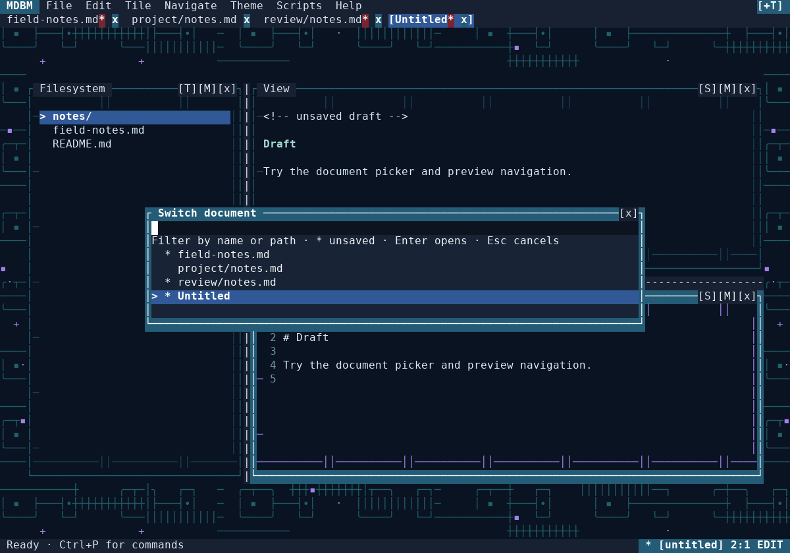
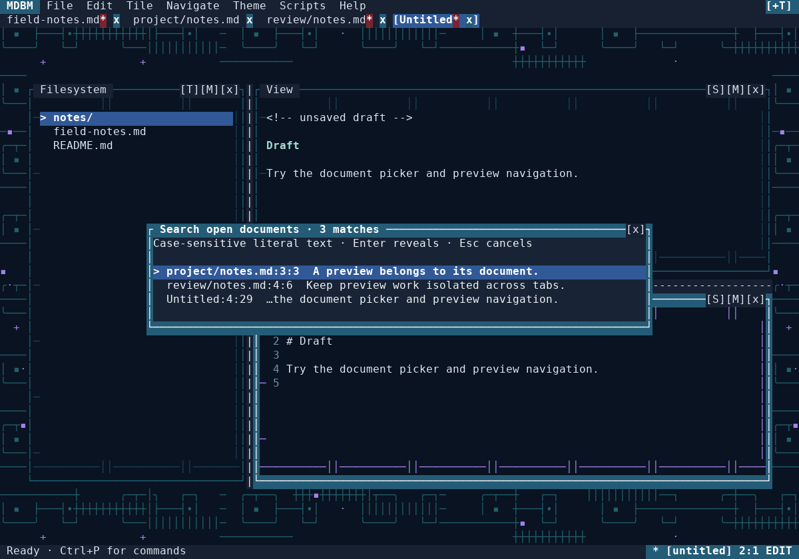

# MDBM 1.0.0a3 — review, implementation plan and verification

Date: 3 November 2026. Review base:
[`a826b4f6d3803b8ec88542cc0a9c4bd9138607ed`](https://github.com/techrote/mdbm/commit/a826b4f6d3803b8ec88542cc0a9c4bd9138607ed).

This increment extends multi-document writing and repairs the correctness
problems found while reviewing it. MDBM remains an implementation alpha. This
work does not claim native-terminal acceptance, incremental Markdown parsing,
or completion of every original product/theme requirement.

## Review findings and selected scope

The review inspected the sole runtime source, the tests and packaging,
product/technical contracts, prior pull requests, and GitHub Actions history.
The repository had no open issues or pull requests at the review snapshot.
MDBM-001/002/003 had delivered document state, tabs and terminal path ingress,
but their temporary validation workflows had all been removed.

| Finding | Consequence | Resolution in this pass |
| --- | --- | --- |
| Recovery replaced the active state's model without rebinding `Workspace.doc` | Subsequent synchronization could overwrite recovered text with the old disk model | Preflight the recovery set, synchronize once, and bind the restored model directly |
| Explicit-file recovery consumed an entire multi-document bundle | Dirty sibling documents could disappear after Restore or Discard | Preserve residual records before consuming the selected snapshot |
| Previous recovery occupied the new session's write slot | Later, fresh autosnapshots, `--no-restore` or clean exit could erase deferred recovery | Archive the previous primary slot before the new session starts writing |
| Recovery mutated documents before validating later records/capacity | A rejected candidate could leave a partially restored workspace | Validate integrity, rooted paths, identities, current dirty conflicts and capacity first |
| The controller treated a queued preview request as guaranteed completion | Replaced jobs or overwritten results could leave a returning tab stuck indefinitely | Reuse completed caches or resubmit; cache valid inactive results under their owner |
| Preview identity omitted recovery model replacement and ASCII wrapping policy | Late results or cached layouts could belong to old text or a different display policy | Advance replacement generations, give new recovery models fresh live IDs, and validate ASCII metadata |
| StateStore used `os.kill(pid, 0)` on Windows | The supposed liveness check could send a console interrupt, including to the test runner | Use non-signalling process handles and a zero-time wait; preserve uncertain owners |
| Reverse Find excluded an adjacent prior match | Repeated matches were skipped | Correct the exclusive-end boundary |
| Every recovery signature included a fresh timestamp | Unchanged dirty state was repeatedly serialized and written | Exclude publication time from the content signature |
| Wheel theme discovery assumed `sys.prefix/share/mdbm` | Relocated installs contained themes but selected only Minimal | Resolve source, target and installed-distribution data locations |
| PTY tests matched visible words in raw incremental output | A cursor move over an unchanged letter produced a false failure | Reconstruct displayed VT cells; retain raw output for terminal cleanup |
| `start.sh` lacked executable mode and no persistent CI existed | Documented launch and ongoing regression coverage were incomplete | Commit executable mode, add package smoke tooling and a permanent three-job matrix |

The Windows diagnosis is supported by [Python's documented Windows
`os.kill` behavior](https://docs.python.org/3/library/os.html#os.kill).
The replacement uses Microsoft's [OpenProcess](https://learn.microsoft.com/en-us/windows/win32/api/processthreadsapi/nf-processthreadsapi-openprocess)
and [WaitForSingleObject](https://learn.microsoft.com/en-us/windows/win32/api/synchapi/nf-synchapi-waitforsingleobject)
APIs. No speculative ScriptRunner change was made to conceal the interruption.

## Implementation plan and completed work

1. **Repair recovery and state ownership.** Reproduce active-buffer loss,
   selective recovery loss, deferred snapshot overwrite and the unsafe Windows
   probe. Add deterministic and real-child regressions before integration.
2. **Repair preview handoffs.** Exercise replaced pending work, overwritten
   completions, inactive caching, changed generations/widths, recovery model
   replacement and ASCII-policy transitions without timing-dependent sleeps.
3. **Extend the multi-document workflow.** Reuse the existing command registry,
   overlays, document collection and guarded save lifecycle for a document
   picker, open-buffer search and Save All.
4. **Make installed delivery repeatable.** Fix theme resource discovery and the
   launcher; build and install wheels outside the checkout; restore permanent
   full-suite Linux/Windows CI.
5. **Review and qualify the combined change.** Cross-review independently owned
   changes, run the complete suite, exercise the new commands through a real
   PTY, inspect actual compositor renders, and update current documentation
   while preserving historical evidence.

## New user workflows

### Switch document

**Ctrl+B**, Navigate → Switch document, or the command palette opens a live
document list. Filename and relative-path tokens filter case-insensitively.
Unsaved buffers carry `*`; untitled buffers are included. Enter/click activates
the selected existing document, preserving its own editor and preview state.
Escape leaves the current document untouched. The picker also works when the
tab strip is too narrow to show every tab.



### Search open documents

Navigate → Search open documents (also in Ctrl+P) searches the current text of
all open buffers, including unsaved edits. It uses case-sensitive literal
matching and retains at most 200 non-overlapping results in tab/source order.
Locations are one-based source line and character column, not terminal-cell
coordinates. Excerpts are bounded and sanitized.

Activating a result validates document object identity, generation and matched
text before selecting the source in Edit. A result cannot silently navigate
into a closed, replaced or subsequently edited buffer. Search scans open
buffers synchronously; it does not index unopened workspace files.



### Save all changed documents

File → Save all changed documents (also in Ctrl+P) processes dirty documents
in tab order through the same Save As, duplicate-destination and disk-fingerprint
guards as an individual save. Cancellation or an error stops the remainder.
Previously successful saves stay published. Full completion restores the
original active document and preserves tile focus and editor selection.

This is deliberately a sequence of guarded saves. It does not promise a
multi-file atomic transaction or roll back earlier successful writes.

Oversized field input and keyboard-dialog file errors now produce a status
error without interrupting the UI. No runtime dependencies were added; `pyte`
is a POSIX-only test dependency for terminal-screen reconstruction.

## Verification record

Runtime source under the local full run:
`07bc7b94e987b0c5651b104635aeabf78e93665c`.
`mdbm.py` SHA-256:
`877c88f9cee633c654cfeca08a80de831386941cb05241eecdf83ec523c8550a`.
Later documentation/render-tool commits leave this runtime source unchanged.

| Check | Result |
| --- | --- |
| Complete local suite, Python 3.12.14 with release dependencies | **723 passed**, zero failures/errors/skips, 136.25 seconds; [machine-readable record](verification/improvement-2026-11-03.json) |
| Real PTY tests, including switch/search/Save All journey | 10 passed |
| Installed wheel, `pip --target` and `pip --prefix`, outside checkout | Passed; 27 themes compile, Neon Circuitry renders at 80×24, console entry point works |
| Existing 96 composed-cell golden configurations | Unchanged baselines; exercised by the full suite |
| Independent recovery failure injection | Original bundle retained when sibling preservation, current recovery publication or scoped discard writes fail; source files unchanged |
| Independent integrated review | No blocking introduced correctness or data-loss issue found in the reviewed diff |
| Visual QA | Actual 120×40 compositor images inspected; generator is `tests/render_workspace_tools.py` |
| Remote CI | Permanent Ubuntu 3.11/3.13 and Windows 3.13 full-suite + wheel checks; exact source/run evidence is attached to the pull request |

The initial local run exposed the raw-stream F9 observation error: the renderer
emitted `F9_OPENED_`, moved across an existing `M`, then emitted `ARKER`.
The displayed word was correct. The new harness has a deterministic regression
for that precise physical-diff sequence, and still checks the real saved file
contents and raw terminal-mode teardown.

The local environment uses prompt-toolkit 3.0.53, markdown-it-py 4.2.0,
mdit-py-plugins 0.6.1, Pygments 2.21.0, wcwidth 0.9.4, Send2Trash 2.1.0,
regex 2026.9.29, pytest 9.2.0, pexpect 4.9.0 and pyte 0.8.2. The real plugin
path is required; no declared runtime requirement was weakened.

Reproduce the principal checks with:

```sh
python -m pip install -e ".[test]"
python -m pytest -q
python -m pip wheel --no-deps --wheel-dir wheelhouse .
python tests/package_smoke.py wheelhouse
```

The optional screenshot generator additionally needs Pillow and the DejaVu
Sans Mono fonts used by the existing gallery tools. Compositor images and
PTY tests do not establish native Windows Terminal or macOS GUI-terminal
acceptance.

## Remaining findings and next pass

These pre-existing limitations were identified during review and retained as
explicit follow-up scope:

| Priority | Remaining limitation | Bounded next action |
| --- | --- | --- |
| High | A v2 recovery bundle can hold 32 documents, while the reader allows approximately eight times the per-file byte budget; sufficiently large or escaped multi-document bundles can be written but rejected on read | Design an aggregate persisted-byte budget or per-document snapshots, including migration and clear over-budget behavior |
| Medium | Recovery discovery examines the first 64 glob entries before timestamp sorting; accumulated deferred archives can hide newer candidates from automatic prompts | Add bounded newest-first discovery and an explicit recovery inventory/retention workflow; do not delete snapshots silently |
| Medium | Two simultaneous processes reaping the same stale lock can race with replacement lock acquisition | Qualify and redesign stale-owner reclamation with a cross-platform ownership protocol |
| Medium | Width-only reflow reparses Markdown; fragment navigation can parse synchronously; open-buffer search and file/recovery writes are synchronous | Separate parse and layout caches, bound UI-thread work, and measure end-to-end latency under representative large documents |
| Medium | POSIX descendants can retain script output pipes after their parent exits; Windows cancellation does not own every descendant | Implement explicit process-tree lifecycle and inherited-pipe cancellation tests |
| Release gate | Native terminal matrix, real trash/junction/permission behavior, semantic theme coverage and accessibility/flash review are incomplete | Follow `TEST_AND_ACCEPTANCE_PLAN.md` and retain honest alpha qualification |

No new public release, tag, deployment, Git integration, workspace-wide index,
or executable theme facility is part of this increment.
