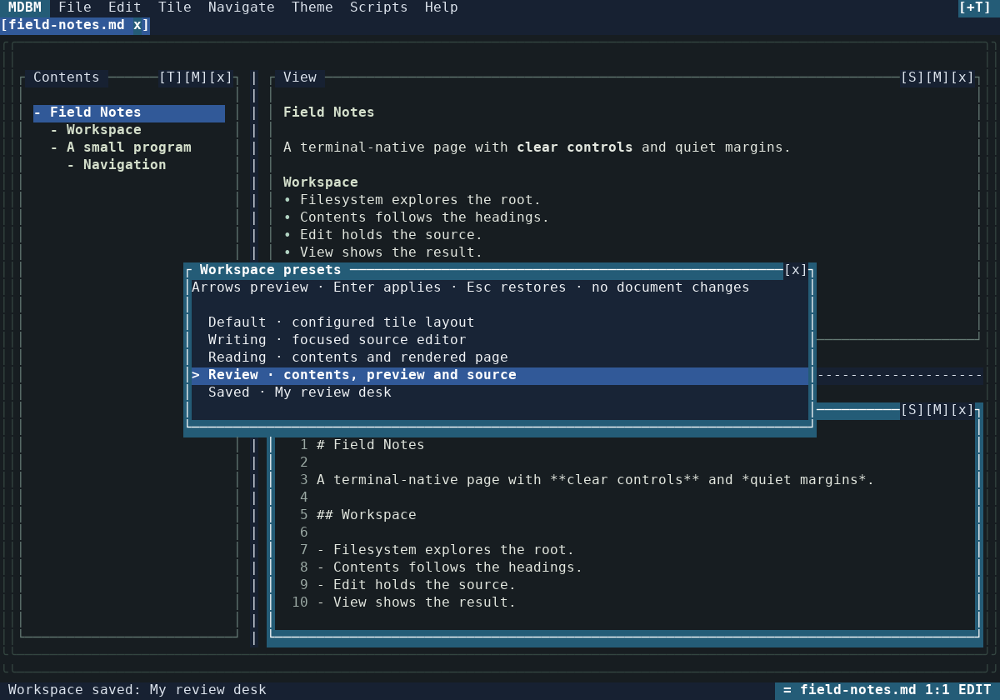
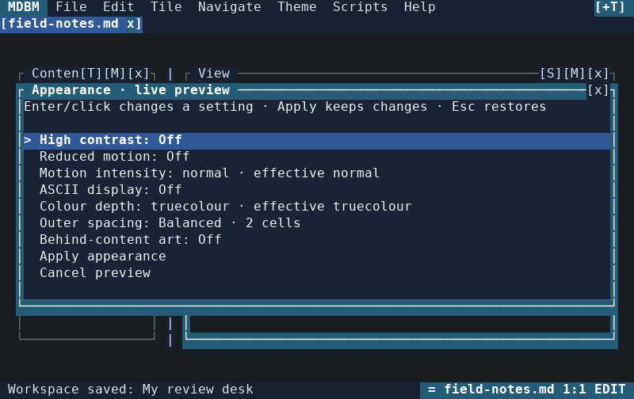
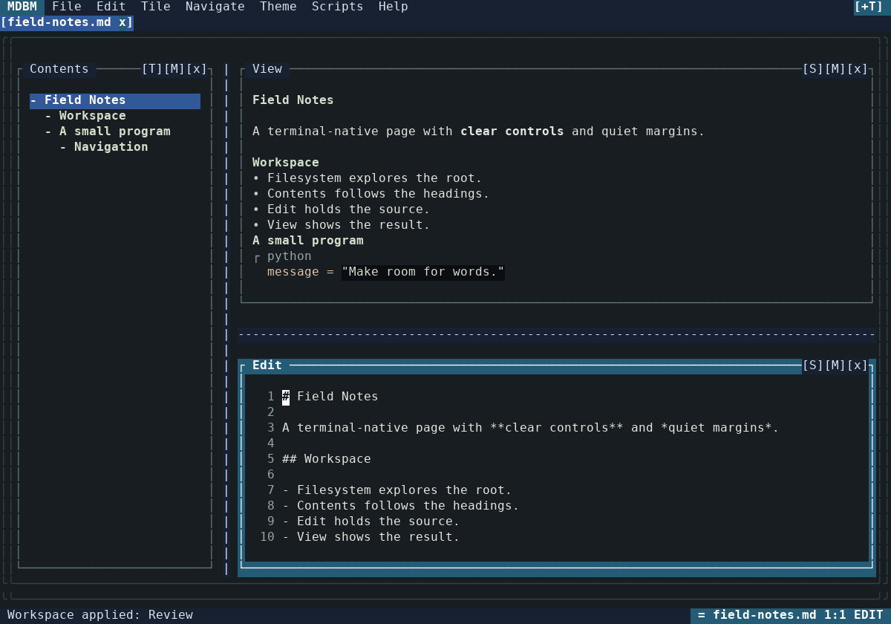

# MDBM tile workspace and appearance contract

This document defines the workspace and appearance behaviour adopted for the
reliability and responsiveness extension. MDBM edits Markdown documents inside
a rooted filesystem. Filesystem, Contents, Edit and View remain persistent
functional tiles; a layout is a presentation of those tiles, not a replacement
for their document models or local navigation state.

## Basis and precedence

The shared design baseline is pinned to `techrote/specdocz` commit
[`04568d38e832ed60dfcba8e8e991dc25d62cc8cb`](https://github.com/techrote/specdocz/commit/04568d38e832ed60dfcba8e8e991dc25d62cc8cb).
The consulted files under `uiuxs/tuiuiux` are:

- [Standalone UI/UX specification](https://github.com/techrote/specdocz/blob/04568d38e832ed60dfcba8e8e991dc25d62cc8cb/uiuxs/tuiuiux/tile-native-gui-tui-uiux-spec.md): normative interaction and presentation baseline.
- [Standalone implementation specification](https://github.com/techrote/specdocz/blob/04568d38e832ed60dfcba8e8e991dc25d62cc8cb/uiuxs/tuiuiux/tile-native-gui-tui-implementation-spec.md): selectively adopted implementation patterns.
- [Tailoring guide](https://github.com/techrote/specdocz/blob/04568d38e832ed60dfcba8e8e991dc25d62cc8cb/uiuxs/tuiuiux/tile-native-gui-tui-spec-tailoring.md): applicability and evidence rules.
- The [MDBM UI/UX example](https://github.com/techrote/specdocz/blob/04568d38e832ed60dfcba8e8e991dc25d62cc8cb/uiuxs/tuiuiux/tile-native-gui-tui-uiux-spec-mdbm.md) and [MDBM implementation example](https://github.com/techrote/specdocz/blob/04568d38e832ed60dfcba8e8e991dc25d62cc8cb/uiuxs/tuiuiux/tile-native-gui-tui-implementation-spec-mdbm.md): concrete precedent based on MDBM's earlier main revision.

MDBM's file integrity, recovery and compatibility requirements take precedence.
This tailored contract then governs workspace and appearance behaviour, alongside
the [product specification](MDBM_PRODUCT_SPEC.md),
[technical design](MDBM_TECHNICAL_DESIGN.md),
[configuration contract](CONFIG_FILE_SPEC.md), and
[theme contract](THEME_FILE_SPEC.md). Later changes to the shared baseline require
an explicit comparison and adoption decision; they do not silently change MDBM.

## Primary workflows

Writers can arrange a focused editor, read a rendered document beside its
contents, or review source and preview together. Presentation changes preserve
the open document set, document identity, unsaved text, selection, undo history,
contents filter/collapse state, and per-document tile memories. Existing
rooted-file guards, save conflict checks and recovery ownership continue to
apply independently of the selected workspace.

### Named workspaces

Tile → Choose workspace preset opens a transactional chooser. Arrow selection
previews a layout. A pointer click on another row previews it; clicking the
selected row or pressing Enter applies it. Escape, outside-click dismissal or
opening the command palette restores the previous layout. Only committed layout
state is eligible for session persistence, even when autosave occurs while a
preview is visible.

| Preset | Visible tiles and focus |
| --- | --- |
| Default | The layout configured in `mdbm.conf` |
| Writing | Edit alone, focused |
| Reading | Contents beside View; View focused |
| Review | Contents beside stacked View and Edit; Edit focused |
| Saved custom layout | Previously saved visibility, placement, focus and split ratios |

Tile → Save current workspace as retains up to eight named custom layouts.
Names contain 1–48 visible characters. Replacing or removing a saved layout
requires an explicit confirmation with Cancel selected initially. The session
stores these layouts; hand-maintained configuration is not rewritten. Presets
store presentation only, without copying document text or resetting memories.
Invalid saved entries are ignored independently. Invalid ratios, tile identities,
extra fields, control characters and over-limit collections are rejected.

### Maximize and restore

Alt+M, Tile → Maximize / restore focused tile, and each tile's context menu use
the same semantic command. Maximizing retains the previous layout. Repeating the
command restores it exactly. Focusing another tile, changing visibility or
resizing leaves maximization and applies to the retained workspace; clicking
inside the maximized tile keeps it maximized. Session persistence
retains that workspace rather than accidentally replacing it with a temporary
single-tile presentation. The reserved Ctrl+T restore route also cancels a
workspace preview before restoring visible tiles.

### Appearance and accessibility

Theme → Appearance and accessibility opens a compact settings panel with live
preview. Keyboard Enter and pointer row activation invoke the same commands.
The panel shows high contrast, reduced motion, motion intensity, ASCII display,
colour depth, outer spacing and behind-content art, including effective motion
and colour modes. Apply commits all changes; Escape, outside-click dismissal or
the command palette rolls them back. Uncommitted values never enter session
state. Committed preferences restore on the next ordinary launch, while
`--no-restore` uses configuration defaults.

Reduced motion limits normal/high motion and never turns motion back on when
the selected intensity is Off. Colour-depth changes update both deterministic
cell-style conversion and the live terminal renderer. Spacing cycles through
Compact (0 cells), Balanced (2 cells) and Spacious (4 cells); saved custom values
remain valid until the user chooses a new spacing option. The geometry solver
continues to clamp margins and decoration to operational minima.

### Quiet Study

Quiet Study is an additional data-only theme for sustained writing and review.
It uses charcoal surfaces, warm light text, sage borders, and a fitted outer
frame. It adds no animation or runtime dependency. Narrow, ASCII, monochrome
and high-contrast modes suppress the ornamental margin. Critical controls,
focus, selection, caret and dialogs keep their host-owned styles.

## Implementation decisions

| Pattern | Decision | MDBM implementation and reason |
| --- | --- | --- |
| Semantic command registry and input parity | Adopt | Workspace, maximize and appearance actions register once and have menu/palette routes; pointer rows dispatch those same commands. |
| Persistent tile identity | Adopt | Layout changes replace immutable `LayoutState`; they do not replace `DocumentModel`, `OpenDocumentState` or `TileMemory`. |
| Arbitrary split tree | Adapt | The existing deterministic left-column/right-stack solver remains appropriate for four established tile identities. Presets vary its validated parameters. |
| Transactional chooser | Extend | The existing theme chooser pattern now covers workspace layouts and a group of appearance preferences; session snapshots explicitly read committed values. |
| Maximization | Extend | A temporary single-tile layout retains the original workspace, preserving an exact restore operation and stable persisted layout. |
| Geometry-derived hit maps and modal capture | Adopt | Full rendered rows become hit targets. Outside dismissal is consumed; small dialogs remove instruction spacing before dropping actionable rows. |
| Declarative themes and protected controls | Adopt | Quiet Study uses the existing closed theme grammar, bounded fitting and fallback rules. No commands, document queries or executable art are introduced. |
| Configuration/session separation | Extend | Dynamic appearance preferences and up to eight named layouts live in validated session fields. `mdbm.conf` stays read-only. |
| Native GUI renderer or detached windows | Not in this product increment | MDBM remains a terminal application. The shared GUI patterns are reference options, not a reason to add a second front end. |
| Asynchronous generation ownership | Adopt | The reliability/responsiveness implementation retains controller ownership and validated background completion identities; presentation transactions do not weaken those checks. |

## Acceptance and qualification boundary

`tests/test_workspace_appearance.py` checks transaction cancellation, commit-only
session serialization, maximize/restore, document/memory preservation, custom
layout bounds and malformed state, command/menu parity, full-row pointer targets,
and Quiet Study's capability fallbacks. The new dialogs are exercised down to
20×6 cells and at 40×12, 80×24, 120×40 and 200×60. At very small sizes, rows
remain keyboard-scrollable and pointer-activatable; explanatory text yields
first. The existing 96 composed-cell golden baselines remain unchanged.

The optional `tests/render_workspace_appearance.py` generates the screenshots
above directly from MDBM's compositor. The screenshots were visually inspected;
they are not mockups. The quiet theme and controls are checked for deterministic
frames, protected host controls and bounded hit geometry across truecolour,
ANSI-256, ANSI-16, monochrome, ASCII, reduced motion and high contrast.

The broader project still requires the native terminal matrix in
[the acceptance plan](TEST_AND_ACCEPTANCE_PLAN.md). Automated compositor tests
and images do not establish manual Windows Terminal/macOS terminal behaviour,
screen-reader support, or every accessibility criterion. Arbitrary docking,
detachable windows, user palette editing and native GUI views are not implemented
by this increment. These boundaries do not waive applicable input, recovery or
accessibility requirements for future work.
