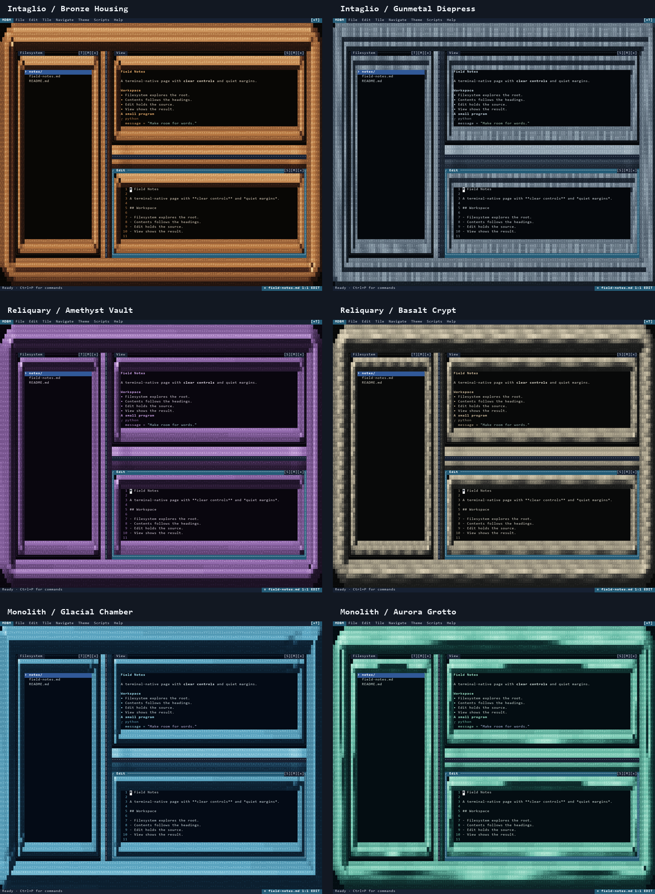

# Theme catalogue

This collection adds 21 themes to MDBM's six original file-based themes. All
appear in the existing theme picker; `minimal` remains the embedded recovery
theme. Theme files are data and cannot run code or operate the workspace.

Launch an ID from this catalogue with:

```sh
python mdbm.py --theme intaglio-bronze examples/solid-relief-showcase.md
```

## Sculpted environments: six connected material treatments

These six use the updated renderer's geometry-fitted frames and per-cell styles.
Update application and theme files together. Their IDs remain unchanged from the
earlier solid-relief drafts; the repeating motif rows have been replaced.

| ID | Environment |
| --- | --- |
| [intaglio-bronze](../themes/intaglio-bronze.theme) | Bronze Housing: rounded cast rims, machined grooves and warm copper grain |
| [intaglio-gunmetal](../themes/intaglio-gunmetal.theme) | Gunmetal Diepress: stepped steel, cut channels and narrow highlights |
| [reliquary-amethyst](../themes/reliquary-amethyst.theme) | Amethyst Vault: faceted purple surrounds and deep inset openings |
| [reliquary-basalt](../themes/reliquary-basalt.theme) | Basalt Crypt: porous stone, rounded mass and chisel-cut lips |
| [monolith-glacial](../themes/monolith-glacial.theme) | Glacial Chamber: slanted ice planes and a continuous fracture |
| [monolith-aurora](../themes/monolith-aurora.theme) | Aurora Grotto: flowing grooves in rounded aquamarine surfaces |

[Guide](../examples/solid-relief-showcase.md) ·
[Gallery](screenshots/solid-relief/gallery.html) ·
[Reduced-scale review](screenshots/solid-relief/squint-review.png)



## Sculpted ASCII studies: three static designs

| ID | Appearance |
| --- | --- |
| [iron-intaglio](../themes/iron-intaglio.theme) | Machined die plate, engraved lettering and concentric boss |
| [obsidian-reliquary](../themes/obsidian-reliquary.theme) | Nested Gothic arches and carved stone piers |
| [glacier-monolith](../themes/glacier-monolith.theme) | Fractured planes and inset ice lettering |

[Guide](../examples/sculpted-ascii-showcase.md) ·
[Plain ASCII artwork](../examples/relief-studies.nfo) ·
[Gallery](screenshots/relief/gallery.html)

## Underground NFO: six distressed scene-art designs

| ID | Appearance |
| --- | --- |
| [rust-bastion](../themes/rust-bastion.theme) | Rusted copper, rivets and extruded RUST lettering |
| [void-cathedral](../themes/void-cathedral.theme) | Amethyst vaults and a dark VOID masthead |
| [acid-overdrive](../themes/acid-overdrive.theme) | Lime machinery, hazard hatching and ACID lettering |
| [cryo-vault](../themes/cryo-vault.theme) | Frozen chrome and fractured CRYO blocks |
| [cinder-relic](../themes/cinder-relic.theme) | Scorched masonry and bronze CINDER lettering |
| [static-revenant](../themes/static-revenant.theme) | Silver STATIC masthead and damaged CRT textures |

[Guide](../examples/nfo-theme-showcase.md) · [Gallery](screenshots/nfo/gallery.html)

## Appearance collection: six reading palettes

| ID | Appearance |
| --- | --- |
| [botanical-ledger](../themes/botanical-ledger.theme) | Warm herbarium paper, green ink and copper accents |
| [tidal-observatory](../themes/tidal-observatory.theme) | Deep ocean, sea glass and coral instrument marks |
| [ember-foundry](../themes/ember-foundry.theme) | Charcoal, ivory, copper rails and sparse sparks |
| [polar-blueprint](../themes/polar-blueprint.theme) | Glacial white, cobalt headings and drafting grids |
| [velvet-nocturne](../themes/velvet-nocturne.theme) | Plum black, pearl text, antique gold and lilac |
| [desert-cartography](../themes/desert-cartography.theme) | Sandstone, terracotta, turquoise and compass roses |

[Guide](../examples/appearance-theme-showcase.md) ·
[Gallery](screenshots/appearance/gallery.html)

## Original themes

The existing `restrained-monochrome`, `neon-circuitry`, `dense-glitch-mosaic`,
`maintenance-ecosystem`, `relay-moth-swarm` and `diagnostic-aurora` themes remain
available. Their golden baselines have not been regenerated for this collection.
